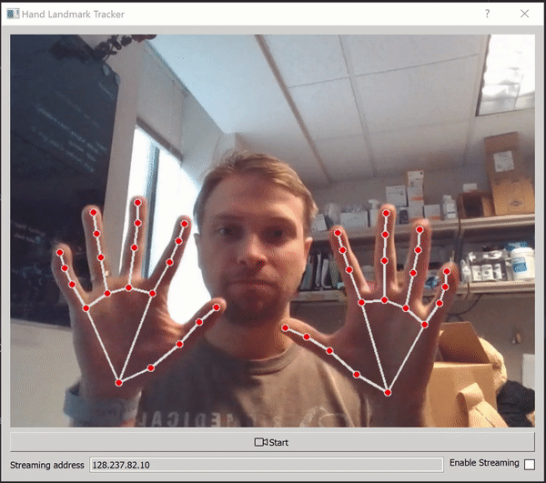

<div align="center">
  
</div>

# MAVIS — Motion Analysis and Visual Interaction Suite

Track hands from a webcam, video, or frames supplied by your own application.
MAVIS provides a camera-free Python API, a desktop demo, recording and replay,
CSV exports, and optional calibrated multi-camera and UDP/LSL workflows.

**Available on [PyPI](https://pypi.org/project/mavis-track/):** the distribution
name is `mavis-track`, the Python import is `mavis_track`, and the command is
`mavis-track`. Version 0.1.0 was published on October 4, 2026.
Existing `handtrack` imports and the `handtracker` command remain available
for compatibility.

## Try the desktop demo

Use Python **3.10–3.12, 64-bit**. The intended desktop platforms are Windows
x64, Linux x64, and macOS Intel/Apple Silicon. The software validation matrix
passes on all four with Python 3.10–3.12; camera permissions and visible desktop
behavior need device checks. See [the audit](AUDIT.md) for the evidence.

Create a virtual environment, then install the desktop extra:

```bash
python -m venv .venv
```

Activate with `.venv\Scripts\activate` on Windows, or
`source .venv/bin/activate` on macOS/Linux, then:

```bash
python -m pip install "mavis-track[gui]"
mavis-track doctor --backend webcam
mavis-track demo
```

The demo starts with one camera and needs no calibration. Select hands, face,
pose, or everything in the window. Use `--source 1` for another camera or
`--source path/to/video.mp4` for a video.
For source development, clone this repository and install `.[gui]` instead.

## Experimental WiLoR hands

Source checkouts include optional WiLoR inference with projected mesh/joint
preview and a `WiLoRTracker` Python frame API. Use the
[WiLoR setup guide](docs/wilor.md) to create its separate `.venv-wilor`
environment, obtain MANO and download checksum-verified checkpoints.

```powershell
./.venv-wilor/Scripts/python.exe -m mavis_track demo --model wilor
```

For the RTX PC, after placing your licensed `MANO_RIGHT.pkl` in
`external/WiLoR/mano_data/`, one command prepares the source, checkpoints and
isolated environment while preserving existing assets:

```powershell
py -3.11 scripts/setup_wilor.py --setup --require-cuda
```

The live Studio model selector can switch between MediaPipe and WiLoR.
Real CPU inference and a live hand overlay have been checked; RTX 3060 inference,
fast mode and accuracy benchmarks remain pending. This first integration supports
single-source and OptiTrack multi-camera preview plus frame APIs. Multi-camera
WiLoR uses one shared model and preserves the exposure/IR controls. Calibrated
multi-view joints can place its mesh and skeleton together in the shared 3D
view when a matching calibration is available. Mesh shape remains model-derived;
the added geometry path has synthetic/software verification and still needs
physical rig evaluation. Recording and streaming use the existing estimator paths.

For all connected OptiTrack cameras:

```powershell
./.venv-wilor/Scripts/python.exe -m mavis_track gui --backend optitrack --model wilor --wilor-device cuda --wilor-fast
```

Click **Start Cameras**, then **Show 3D View** for the calibrated WiLoR mesh and
skeleton. See the [multi-camera guide](docs/wilor.md#optitrack-multi-camera-gui)
for live-feed versus matched-overlay display and validation limits.

The OptiTrack GUI also supports named, timestamped raw-video trials with optional
inference and Nexus network capture requests. Sync setup stays in a separate
dialog; detailed diagnostics are saved with each trial. See the
[Vicon synchronization workflow](docs/vicon-sync.md) for hardware wiring,
alignment reports and separate synchronized replay.

## Include MAVIS in your project

The base package does not require Qt, pandas, or LSL. Add `mavis-track`
to your project's dependencies, or install it with `python -m pip install mavis-track`.
Pass frames from your existing capture loop:

```python
from mavis_track import HandTracker

with HandTracker(max_hands=2) as tracker:
    result = tracker.process(frame_bgr)  # Your uint8 image, shape (height, width, 3)
    for hand in result.hands:
        print(hand.track_id, hand.handedness, hand.landmarks.shape)
        # (21, 3) read-only coordinates owned by this result
```

MAVIS does not open a camera or window in this API. Empty frames produce an
empty `result.hands` tuple. Supply `timestamp=seconds` for a source clock
or use the default monotonic host clock. RGB input uses `color="rgb"`.
See [the integration guide](docs/integration.md) and the complete
[webcam example](examples/01_basic_tracking/mavis_webcam.py).

## Record, replay, and export

```bash
mavis-track record --source 0 --frames 300 --max-hands 2 --session-name demo
mavis-track record --mode hand-body --source 0 --frames 300 --session-name reach
mavis-track replay recordings/demo
mavis-track export recordings/demo
```

Recordings contain a numeric `landmarks.npz` and `session.json`; optional
`--save-video` adds annotated video. Export writes rectangular landmark,
angle, and hand identity CSVs. Missing hands use a validity mask and NaNs.
Replay honors recorded timestamps, including variable camera timing.

For synchronized single-person hand/body processing, import `HandBodyTracker`
from `mavis_track`. It returns body landmarks and both hands from the same frame,
with per-region missing-data, visibility, bounds, and timing flags. Combined
recordings retain body visibility and quality metadata; replay/export support
both regions. See the [combined API guide](docs/integration.md#combined-hand-and-body-tracking)
for usage and coordinate definitions.

## Coordinates and measurement limits

- `landmarks`: image-normalized x/y; z is the model's wrist-relative depth,
  scaled similarly to x. These coordinates are not calibrated world meters.
- `world_landmarks`: optional hand-centered MediaPipe model estimates in
  meters. Separate hands do not share a global origin.
- `angles`: 14 named geometric finger flexion estimates in degrees. The
  `angle_space` field identifies the coordinates used. These are not
  validated clinical joint measurements.
- `track_id`: short-lived association across adjacent frames. Missing hands
  reset association; IDs do not identify a person.

## Advanced workflows

Install `".[gui,stream]"` for desktop streaming. UDP can also be used with
the base package. Calibrated multi-camera tracking currently assumes **one
hand shared across views**; unrestricted multi-person/two-hand matching
requires further work.

```bash
mavis-track board --backend webcam
mavis-track calibrate --backend webcam
mavis-track gui --backend webcam --advanced-hands
```

Calibration uses matching image dimensions, held-out quality checks, and
validated camera matrices. Files live in a user data directory, with existing
`HANDTRACK_WEBCAM_CALIBRATION_DIR` and
`HANDTRACK_OPTITRACK_CALIBRATION_DIR` overrides supported. Source indices can
change when cameras are replugged: verify physical order or recalibrate.

OptiTrack calibration (`mavis-track calibrate --backend optitrack`) has two stages:

1. **Individual camera intrinsics.** Start with camera 0 and show the board
   close enough to resolve its corners clearly. Vary its position across the
   image, depth, and tilt; hold it still during each three-second countdown.
   Only the current camera needs to see the board. The target is 36 captures
   per camera by default. The preview pauses before each next camera; press
   Space when ready. Keep the cameras and lens settings fixed throughout.
2. **Camera alignment.** After intrinsic quality checks pass, press Space to
   start alignment. Show the board to any two cameras with at least six shared
   corners. The preview chooses a pair and shows its progress; each pair has
   the same capture target. Build a connected set, such as 0–1, 1–2, and 2–3.
   All cameras do not need to see the board together. Lens parameters remain
   fixed while alignment is solved.

Space pauses/resumes capture and resets the countdown. Q advances to the next
camera after at least 20 intrinsic captures, or finishes alignment once pairs
with at least 20 captures connect every camera. Esc cancels and preserves the
published calibration. Alignment finishes automatically when pairs meeting
the full target connect every camera. Quality checks still apply before
publication.

Detected corners, IDs, camera identity, board geometry, and fitted intrinsics
are checkpointed beside the calibration file as
`calibration_observations_<timestamp>.npz`. These numeric archives preserve
captured data for offline investigation, including cancelled or failed runs;
they are not published tracking calibrations. Automatic resume is not provided.

Recompute a saved session without opening cameras:

```bash
python -m handtrack.applications._calibration_replay path/to/calibration_observations_TIMESTAMP.npz --output outputs/recovered_calibration.npz
```

Replay applies the same intrinsic, stereo, and board reconstruction quality
checks. Stereo error fits a shared board pose to both images while holding
lens parameters and the camera-to-camera transform fixed. The output is saved
only after all checks pass; choose the output path explicitly.

Validate the active calibration using a rigid ChArUco target with the configured
board layout. Measure the physical distance between two printed ChArUco corner
intersections, identified by their IDs in the preview. Enter your measurement
in millimeters; it is not inferred from the configured square size. For example,
**if you measured 200 mm** between corners 0 and 19:

```bash
mavis-track validate-calibration --backend optitrack --distance-mm 200 --corner-ids 0 19
```

The preview highlights those two corners. Place the target on a stationary
support at the requested workspace location and press Space. A three-second
countdown precedes 60 samples at up to 10 Hz. At least two cameras must see both
corners; other cameras need not see the board. Move to the next requested
location after each trial. The default locations are center, left, right, near,
far, high, and low. A second visit to each location measures return displacement;
use a physical fixture to reproduce the same position and orientation. With
one location, remove and replace the target between visits. Space pauses and
discards the current incomplete trial; Q saves and stops, and Esc cancels while
retaining completed trials and available partial samples.

Use `--locations center left right`, `--trials 2`, and `--samples 60` to customize
the sequence. `--dictionary DICT_5X5_50` skips dictionary auto-detection, and
`--calibration path/to/file.npz` selects a different calibration. Both OptiTrack
and webcam backends are supported. There is no calibration fitting or smoothing
during validation: selected corners are triangulated freely, without imposing
their known distance or a board pose.

Timestamped folders under `outputs/calibration_validation/` contain `report.json`
and `samples.csv`. Reports include signed distance bias, distance RMSE and maximum
absolute error, distance standard deviation, 3D endpoint RMS jitter, and
return-to-position displacement by location. Jitter includes any target motion;
return displacement also includes repositioning error. CSV coordinates are in
millimeters in the calibration's camera-0 frame. Reused/stale camera frames,
near-parallel rays, negative depth, and excessive reprojection error are rejected;
the rejection counters are detection-attempt counts, not independent samples.
Host timestamps do not guarantee synchronized camera exposures. No vendor
accuracy grade or pass/fail tolerance is assigned.

Using the original calibration board is a consistency check. For independent
validation, use a separate rigid target with the same detectable layout and an
independently measured endpoint distance; add `--independent-target` to record
that declaration in the report. This flag does not itself verify the target.

OptiTrack remains an optional Windows SDK integration. On 2 November 2026, the
operator reported that completing the USB driver installation resolved
zero-camera discovery on a new PC.
**Complete the official Camera SDK installer's USB driver step on each new PC.**
The operator confirmed that the remaining SDK installation could then be
cancelled after driver completion. Python installation/runtime recovery does not
install USB drivers. See the tracked [external setup guide](external/README.md)
for the driver-only workflow and verified local runtime recovery for Python 3.11
x64; source installations discover that runtime automatically.
Use `OPTITRACK_CAM_PY_PATH` for another compatible binding.

For illumination, SDK frame timing and OptiHub synchronization controls, close MAVIS and run
`python external/setup_optitrack.py --upgrade-binding` in the Python 3.11 x64
environment. This installs the checksum-verified binding-only release without
a compiler. Doctor reports frame-timing and sync-control API readiness; actual
electrical synchronization still needs a rig check. Use **Recording / sync setup…**
to apply external/internal 50 Hz presets and exposure timing output.
Start tracking afterward and choose **Max available** for one/all
cameras; calibration also supports I/K intensity, M maximum and H high power.


## Development and release

```bash
python -m pip install -e ".[dev,gui,io,stream,docs,release]"
python -m pytest -q
mkdocs build --strict
python -m build
python -m twine check dist/*
```

Publishing is gated by the full software matrix and package checks.
[Audit](AUDIT.md) · [Release checklist](RELEASE.md) ·
[Documentation](https://jshulgach.github.io/Hand-Landmark-Tracker/) ·
[Issues](https://github.com/Jshulgach/Hand-Landmark-Tracker/issues)

MAVIS source is MIT licensed. Optional Qt dependencies and proprietary SDKs
retain their own licenses; see [third-party notices](THIRD_PARTY_NOTICES.md).


## Repository layout

| Path | Purpose |
| --- | --- |
| `src/mavis_track/` | Public frame API, numeric sessions and incremental recording |
| `src/handtrack/` | CLI, processing, GUI and compatibility interfaces |
| `src/unity_hand_tracking/` | Active advanced webcam/OptiTrack implementations and Unity compatibility |
| `tests/` | Hardware-independent regression tests |
| `examples/` | Runnable examples and retained research workflows |
| `research/camera-placement/` | Preserved historical Flex placement evaluations |
| `outputs/`, `recordings/` | Ignored new experiment outputs |
| `build/`, `site/`, tool caches | Ignored packaging outputs; cleared after use |

Recording, replay and export support bounded chunks for long sessions; see the
[streaming guide](docs/integration.md#long-recordings-and-bounded-memory-analysis).
The live studio keeps capture/inference off the GUI thread and displays the
latest preview without a backlog. Historical placement reports are indexed in
[research](research/camera-placement/README.md).


Research datasets, model weights, local legacy scripts and validation snapshots
are stored outside the checkout in `~/Documents/Hand-Landmark-Tracker-Research/`.
The examples accept `--data-dir` and `--video`; `MAVIS_DATA_DIR` can select another
shared data root. See [external research data](docs/research-data.md).
